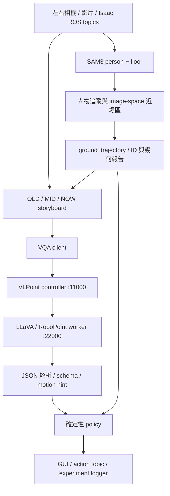

# 架構與程式導覽

## 系統實際在做什麼

現行 `future_risk_vqa` 把感知、語意與決策拆開：SAM3 找人，輕量 tracker 維持每台相機自己的 ID；時序影像交給 LLaVA／RoboPoint 描述姿勢、活動與未來方向；Python 規則決定提示。左右相機的 ID 是 `L*`、`R*`，沒有跨相機 re-ID。

SAM3 在這裡有三個不同概念，不能混為同一個新模型：

| 路徑 | 現況 |
|---|---|
| `future_risk_vqa` 的 SAM3 tracker | 使用 Transformers `Sam3Model` + `Sam3Processor` 載入 HF 權重，偵測 person／floor |
| worker 的 SAM3 conditioning／proposal | 選用影像輔助流程；checkpoint 測試腳本會關閉 conditioning，視覺 encoder 仍為 CLIP |
| SAM3 直接取代 VLM encoder | 有實驗性 wrapper 與研究提案，沒有完成驗證的 foundation 訓練 package |

`sam3/` Git 子模組與 HF 模型快取彼此獨立；更新 native repo 不等於更新 tracker 使用的 HF 權重。

## 重要資料流

| 輸出 | 生產者 | 用途 |
|---|---|---|
| `/future_risk/person_tracks` | `sam3_person_tracker_node.py` | timestamp、bbox、腳點、ID 與近場區狀態 |
| `/future_risk/geometry_prediction` | `ground_trajectory_node.py` | track 對齊、Kalman 預測與可選 zone/TTE |
| `/future_risk/vlm_events` | `future_vqa_node.py` | 已解析語意、schema errors、原始 motion 與品質診斷 |
| `/future_risk/decision` | `future_policy_node.py` | JSON 決策、原因、來源與參數快照 |
| `/future_risk/action` | `future_policy_node.py` | `STOP`／`DANGER_WARNING`／`CONTINUE`／`NO_RESPONSE`／`OBSERVE` |

複合 topic 主要以 `std_msgs/String` 承載 JSON；[SCHEMA](../ros2_ws/src/future_risk_vqa/docs/SCHEMA.md) 與 `schema.py` 定義欄位。action topic 目前供觀察與紀錄。另一條 `white_point_pipeline`／`VLServo` 操作路徑可控制機器人，與此處風險提示不同。

預設 `future_behavior_policy` 在啟用近場 image-space 區域時優先檢查，再依語意決定提示。目前影片設定啟用該區，live／Isaac 設定關閉。程式在缺 geometry 或沒人時輸出 `NO_RESPONSE`；近場區內可能維持 `STOP`，過期 tracking 或不可用 VQA 通常產生警告。精確順序見 `future_policy_node.py`，不要只看 `policy.py` 的純函式。紅區為近似影像區域，不能解讀成已標定的一公尺。

## 目前設定與實驗限制

兩份 source YAML 目前皆為 SAM3 `device: cpu`、`storyboard_mode: track_crops`、`vqa_inference_mode: per_track`、`motion_source: tracking_hint`。`hybrid + joint` 仍可作比較，但不是目前 YAML 預設。VLM 本身的原始方向保留在 audit 欄位；融合後方向分數不能全部算成 VLM 能力。

影片設定用 normalized debug homography；Isaac 設定的 metric 校正仍未完成。zone/TTE 預設關閉。9 月 CPU SAM3 試驗第一輪約 57 秒，且 VQA 解析失敗；指定 `inference_hz: 2.0` 是排程目標，不代表達到 2 FPS。詳細測試背景見 [CPU 試驗](../robopoint_runtime/SAM3_CPU_TRIAL.md)。

## 如何讀程式

以 `ros2_ws/src/future_risk_vqa/` 為起點：

1. `setup.py` → `launch/` → `config/`：先確認會啟動哪些節點、用哪一份 YAML、哪些 launch 值覆蓋 YAML。
2. `future_risk_vqa/schema.py`、`docs/SCHEMA.md`：理解每層的輸入輸出。
3. `sam3_person_tracker_node.py`、`tracking.py`、`geometry.py`、`motion.py`：追蹤、去重、腳點與 motion hint。
4. `storyboard.py`、`prompt.py`、`model_client.py`、`future_vqa_node.py`：影像時間對齊、模型請求、解析和融合。
5. `policy.py`、`future_policy_node.py`：純規則與實際 ROS freshness／優先序。
6. `ui_presenter.py`、`research_gui.py`、`experiment_logger_node.py`：結果解釋與保存。
7. `test/`：閱讀邊界條件與可重現的預期結果。

需要改模型載入才往 `ros2_ws/src/vlpoint/point/model/builder.py`、`model/language_model/`、`model/multimodal_encoder/` 看；HTTP 路由從 `point/serve/controller.py` 與 `model_worker.py` 看起。

## 保留的程式角色

`risk_vqa` 是單影片 YOLO／TTC + VLM 基準，`risk_vqa_sim` 是雙相機 temporal VQA／zone 基準；各有 schema、policy 與測試，並非可直接刪除的副本。VLServo 的 `visual_servoing_demo.py` 仍被 `vlservoing.py` 動態呼叫，`visual_servoing_demo_llm.py` 也仍被 `humanvl.py` 使用，因此保留原位置。選點、校正、語音與上游音訊元件維持選用；不要為了跑風險研究直接建置整個 `src/`。
