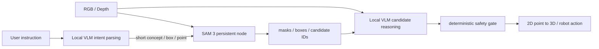
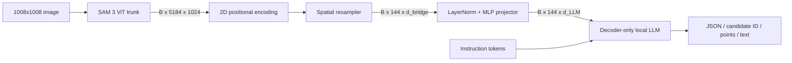
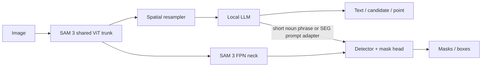

# VLMotion：以 SAM 3 Image Encoder 改造本地 VLM 的完整設計

> 封存狀態（2026-10-14）：保留當時的架構稽核與實驗假設；不是現行部署指南，數字未於本次重測。現況見 [架構](../ARCHITECTURE.md)。

> **範圍更新（2026-08-07）：** 使用者的正式目標已改為訓練單一 checkpoint、端到端的 foundation VLM，而非以 SAM3 作為外部工具。本文件保留作 repository audit、低成本 baseline 與舊架構工程參考；新的主計畫請見 [SAM3-Native Foundation VLM 計畫](../research/SAM3_FOUNDATION_VLM_PLAN.md)。

> 文件日期：2026-08-07\
> 狀態：設計與 repository audit；尚未實作 encoder hard-swap 訓練管線\
> 部署原則：正式推論完全本地，不依賴 GPT、Gemini 或其他雲端 API

## 0. 結論先講

可以做，但不能把 CLIP model name 換成 `facebook/sam3` 後就直接使用。

對這個 repository，最重要的結論是：

1. **不需要、也不應從頭訓練 SAM 3 或 LLM。**
2. 若只是把完整 SAM 3 當作候選區域、mask、box 或 tracking 工具，**可以先完全不訓練**。
3. 若真的將 VLM 的 image encoder 換成 SAM 3，**至少要重新初始化並訓練 vision resampler/connector**；原本 CLIP projector 即使 shape 相同也不能沿用。
4. SAM 3 在 1008×1008 下產生 `72×72 = 5,184` 個 trunk tokens，現有 CLIP 約為 576 個。**必須先壓縮到約 64–256 tokens**，否則舊 LLaVA context 會溢出，LLM prefill 也會非常昂貴。
5. SAM 3 的強項是 mask、region、small object 與 localization，不代表一般 VQA、OCR、常識或 caption 一定比原 VLM encoder 好。若兩者都要，應採 **SAM 3 工具式架構**或 **共享 trunk 的雙分支架構**，不是單純 hard swap。
6. 目前專案內的 direct `Sam3VisionTower` **實際沒有正確載入預訓練 vision 權重**；在現有 container 以 Transformers 5.13.1 驗證時，有 538 個 missing keys、1,797 個 unexpected keys。這必須先修。

### 我對本專案的最終推薦

正式產品主線：

```text
Qwen3.5-4B（本地 4-bit；資源更緊時用 2B）
        +
常駐的完整 SAM 3 detector/mask 模型
        +
SAM candidates / masks / depth 的結構化輸入
```

研究型 encoder-swap 支線：

```text
SAM 3 ViT trunk @ 1008
→ 2D-aware 144-token resampler
→ LayerNorm + MLP projector
→ Qwen3-4B text LLM 或先保留現有 LLM
→ connector alignment
→ LLM LoRA + robotics/grounding SFT
```

如果重點是「按鈕、車輛、物件、可操作區域的準確座標」，產品主線通常更快得到可靠結果；如果目標是研究一個端到端、共享 dense feature 的新 VLM，才繼續做 encoder-swap 支線。

---

## 1. 現有 VLMotion 的模型狀態

目前 VLPoint 是舊版 LLaVA/RoboPoint 架構：

```text
RGB image
→ image processor
→ CLIP vision tower
→ mm_projector
→ image token embeddings
→ Vicuna/LLaMA decoder
→ text / normalized points
```

主要預設 checkpoint 是 `wentao-yuan/robopoint-v1-vicuna-v1.5-13b` 或 `liuhaotian/llava-v1.5-13b`。兩個 launch file 的預設不一致，正式實驗前應先固定唯一 baseline。

### Repository 內已有三種 SAM 3 路徑

| 路徑 | 現況 | 是否真的替換 encoder |
|---|---|---:|
| CLIP + SAM3 saliency conditioning | 用 SAM feature norm 改暗部分 RGB，再送入 CLIP | 否 |
| SAM3 candidate detector | 完整 SAM3 找 box，再把 label/座標附加到 prompt | 否 |
| `Sam3VisionTower` | 企圖以 SAM3 trunk token 取代 CLIP token | 是，但目前不可用 |

相關程式：

- Encoder 選擇：`ros2_ws/src/vlpoint/point/model/multimodal_encoder/builder.py`
- Direct wrapper：`ros2_ws/src/vlpoint/point/model/multimodal_encoder/sam3_encoder.py`
- CLIP conditioning：`ros2_ws/src/vlpoint/point/model/multimodal_encoder/clip_encoder.py`
- Projector：`ros2_ws/src/vlpoint/point/model/multimodal_projector/builder.py`
- Image tokens 插入 LLM：`ros2_ws/src/vlpoint/point/model/llava_arch.py`
- 訓練入口：`ros2_ws/src/vlpoint/point/train/train.py`
- Runtime SAM3 candidates：`ros2_ws/src/vlpoint/point/serve/model_worker.py`

### 已確認的 blockers

#### 1. Direct wrapper 載入的是隨機初始化 vision model

目前程式直接呼叫：

```python
Sam3VisionModel.from_pretrained("facebook/sam3")
```

但完整 checkpoint 的 vision keys 位於 `detector_model.vision_encoder.*`。在本專案 container 的實測結果是：

```text
Sam3VisionModel.from_pretrained:
  missing keys:     538
  unexpected keys: 1,797

Sam3Model.from_pretrained:
  missing keys:       0
  unexpected keys:    0
```

正確且較穩定的載入方式是先載入完整 detector model，再取出 encoder：

```python
from transformers import Sam3Model, Sam3Processor

sam3 = Sam3Model.from_pretrained("facebook/sam3")
vision_encoder = sam3.vision_encoder

inputs = processor(images=image, return_tensors="pt")
vision = sam3.get_vision_features(pixel_values=inputs.pixel_values)
tokens = vision.last_hidden_state
```

Hugging Face 官方文件也以 `get_vision_features()` 重用 image embedding：[SAM3 Transformers docs](https://huggingface.co/docs/transformers/model_doc/sam3)。

#### 2. 5,184 visual tokens 會使現有 context 失效

SAM 3 的固定設定是：

```text
input:         1008 × 1008
patch size:    14
grid:          72 × 72
trunk dim:     1024
raw tokens:    5,184
```

現有 worker 直接使用 `vision_tower.num_patches` 扣除 context；如果換成 SAM 3，舊模型的 2K/4K context 很可能直接回覆 `Exceeds max token length`。訓練端則會在加入 image tokens 後截斷 sequence，嚴重時答案 labels 全被截掉，表面上在 training、實際上沒有有效 supervision。

#### 3. 目前 `@torch.no_grad()` 阻斷 vision fine-tuning

`Sam3VisionTower.forward()` 被無條件 `@torch.no_grad()` 包住；即使日後設定 unfreeze，也不會有 vision gradient。應改為依 freeze 狀態決定 context，而非 decoration。

#### 4. 舊 projector 不能沿用

CLIP ViT-L 與 SAM 3 trunk 剛好都可能是 1024-D，因此舊 projector 甚至可能無 shape error 地載入；但兩者的 feature distribution、位置結構與訓練目標不同。這是一種危險的 silent failure。換 tower 時必須重建 projector/resampler。

#### 5. Runtime 重複載入與重複編碼

目前 candidate detector 每個 request 都：

1. `Sam3Model.from_pretrained()`；
2. 推論；
3. 刪掉 model 與清空 cache。

如果同時開啟 SAM3 conditioning，單張影像還可能再載入一套 SAM3 vision encoder、再跑一次 CLIP。正式版本應將 SAM3 常駐，並以 `frame_id` 共用同一份 vision features、detections 與 masks。

#### 6. 環境與儲存空間

Audit 當下環境：

```text
GPU:       NVIDIA GeForce RTX 5070
VRAM:      12,227 MiB
磁碟可用: 約 21 GiB（filesystem 已使用 98%）
```

21 GiB 不足以安全保留多個 LLM checkpoint、SAM3、optimizer state、feature cache 與訓練 checkpoints。開始訓練前必須先規劃另一個 model/data volume；不要直接把大量 cache 寫進 repository。

---

## 2. SAM 3 適不適合當 VLM encoder？

SAM 3 是統一的 promptable image/video segmentation 模型，完整模型約 848M parameters，detector 與 tracker 共用 vision backbone。官方架構使用 1008 輸入、ViTDet-style 32-layer vision trunk、FPN neck，並支援 text、box、point 等 prompts。[Meta SAM 3 paper](https://ai.meta.com/research/publications/sam-3-segment-anything-with-concepts/)、[官方 repository](https://github.com/facebookresearch/sam3)。

### 適合的情境

- Referring expression grounding
- 小物件、按鈕、零件、車輛與操作區域
- Box/mask/point prediction
- Robot affordance 與物件關係
- Video object tracking
- 希望 detector、mask head 與 VLM 共用 image computation

### 不保證更好的情境

- 一般 caption、常識 VQA
- OCR、文件、圖表
- 全域語意分類
- 細長文字與 UI text recognition
- 需要低功耗、低解析度即時推論

SAM 3 官方也明確把複雜 reasoning query 的工作交給 MLLM/SAM 3 Agent，再讓 MLLM 產生短 noun phrase 或 geometry prompts 給 SAM 3。因此「VLM reasoning + SAM3 tool」是官方概念相符且低風險的 baseline，不是退而求其次。

### SAM 3 還是 SAM 3.1？

SAM 3.1 的主要改進是 Object Multiplex 與多物件 video tracking efficiency；官方 image builder 仍以 base SAM 3 checkpoint 為主。若只抽 image encoder，第一版建議使用 `facebook/sam3`；若做多物件影片 tracking，再測 `facebook/sam3.1`。[SAM 3.1 release notes](https://github.com/facebookresearch/sam3/blob/main/RELEASE_SAM3p1.md)

---

## 3. 三種可行架構

### 3.1 方案 A：本地 VLM + 完整 SAM 3 工具（產品首選）



建議行為：

1. 本地 VLM 將「幫我按紅色按鈕下方那一顆」解析成概念與空間限制。
2. SAM 3 回傳 top-K masks、boxes、scores。
3. VLM 只選 candidate ID，不自行幻想 pixel coordinate。
4. 實際 point 由 mask center、距離場、可達區域或 depth 幾何計算。
5. Safety gate 驗證 depth、工作空間、碰撞與 confidence。

優點：

- 可零訓練先做 baseline。
- 保留原生 SAM3 detector/mask 能力。
- 可以分別量測 proposal recall 與 reasoning accuracy。
- 可更換本地 VLM，不必重訓 SAM 3。
- 最適合 12GB GPU 與事件驅動的 robot command。

限制：

- 可能有兩個 vision towers。
- 若 VLM 也吃原圖，仍有重複 image compute。
- 需要 prompt routing 與結構化 candidate schema。

第一版應先把現有每-request load 改成 persistent singleton，並將 concurrency 設為 1。

### 3.2 方案 B：SAM 3 encoder hard swap（研究 MVP）



建議第一版 connector：

```text
SAM trunk [B, 5184, 1024]
→ reshape [B, 1024, 72, 72]
→ AdaptiveAvgPool2d(12, 12)
→ flatten [B, 144, 1024]
→ LayerNorm(1024)
→ Linear(1024, d_LLM)
→ GELU
→ Linear(d_LLM, d_LLM)
```

先用固定 12×12 pooling 建立可信 baseline，再比較 locality-aware Perceiver/Q-Former。第一版不要一開始就堆複雜 resampler，否則難以判斷錯誤來自 encoder、token compression 還是訓練。

第二版可用：

```text
LN(1024)
→ Linear(1024, 768)
→ 2–4 layers 2D-aware Perceiver
→ 144 spatial queries
→ MLP(768, d_LLM)
```

learned queries 必須帶 2D 位置或 locality bias；完全無空間結構的 query resampler 可能傷害 pointing。

### 3.3 方案 C：共享 SAM 3 trunk、VLM 與 mask 雙頭（研究最終版）



這是能力最完整的版本：

- LLM 分支使用 trunk tokens 做語言與空間 reasoning。
- SAM 分支保留 FPN/detector/mask head 做 pixel-level localization。
- 複雜語言先由 LLM 轉成 canonical short phrase，再走 SAM 原生 text encoder。
- 日後才研究 `<SEG>` hidden state 到 SAM 256-D prompt space 的 adapter。

第一版不要直接把 LLM hidden state 當 SAM prompt embedding；SAM detector 的 prompt sequence、attention mask、presence token 與 hard negatives 都有特定 contract，僅接一層 linear 通常不夠。

### Token budget 建議

| Visual tokens | 建議用途 | 主要風險 |
|---:|---|---|
| 64 | 快速 prototype、粗 VQA | 小物件與 precise point 容易流失 |
| 128–144 | 本專案預設 | 品質與延遲平衡 |
| 256 | 密集場景、OCR、細粒度 grounding | prefill/VRAM 增加 |
| 5,184 | 不建議 | context、attention 與 latency 不可接受 |

更進階的 dynamic budget：

```text
64 global tokens
+ top-4 proposals × 32 ROI tokens
= 最多 192 visual tokens
```

---

## 4. 本地模型選擇

### 4.1 最推薦的角色分工

| 角色 | 推薦模型 | 理由 | 注意事項 |
|---|---|---|---|
| 目前 controlled baseline | RoboPoint v1 Vicuna 13B | 已針對 spatial affordance 訓練 | 13B + SAM3 對 12GB 太重 |
| 產品主線本地 VLM | **Qwen3.5-4B** | 原生圖文、中文/多語、Apache 2.0、適合 structured output | 不建議第一版拆掉其原 vision tower |
| 更小 edge VLM | Qwen3.5-2B | 讓 12GB 有更多 SAM3 activation 空間 | 要以真實 domain benchmark 驗證能力 |
| Hard-swap 的 text LLM | **Qwen3-4B-Instruct-2507** | 純文字 decoder、中文/多語、Apache 2.0、bridge contract 較乾淨 | 現有 repo 需新增 Qwen language wrapper |
| 較高品質 hard-swap | Qwen3-8B | reasoning 較強 | 訓練與 edge VRAM 顯著增加 |
| 替代 native VLM | Gemma 4 E4B / 12B | 官方主打本地 multimodal | 授權、中文與框架需另行評估 |
| OpenAI 本地模型 | gpt-oss-20b | Apache 2.0、可完全本地 | text-only、主要英文；權重本身約需 16GB，不適合目前 12GB + SAM3 |

Qwen3.5-4B 是原生 vision-language model，官方 model card 列出 Transformers、vLLM、SGLang 等本地執行方式與 Apache 2.0：[Qwen3.5-4B model card](https://huggingface.co/Qwen/Qwen3.5-4B)。Qwen3 系列有 4B/8B 等尺寸與大量語言支援：[Qwen3 official repository](https://github.com/QwenLM/Qwen3)。

### 為什麼不把 Qwen3.5-4B 當第一個 hard-swap target？

它是 native multimodal architecture，vision tower、multimodal RoPE 與 language stack 已共同對齊。硬換其 encoder 的工程與訓練變因比 LLaVA-style `vision → connector → decoder` 多。它非常適合當：

- 原生本地 VLM baseline；
- SAM3 tool controller；
- teacher model；
- 產品主線。

若目標是研究 encoder transplant，純文字 Qwen3-4B decoder 或先保留目前 LLM 更容易做 controlled experiment。

### GPT 可以直接本地部署嗎？

- OpenAI hosted GPT models 不提供可下載權重，因此不能作為離線正式推論模型。
- `gpt-oss-20b` 是可下載的 OpenAI open-weight text model，官方說 MXFP4 版本約需 16GB memory，但它不是 vision model，仍需 SAM3 connector training。[OpenAI gpt-oss announcement](https://openai.com/index/introducing-gpt-oss/)
- 對目前的中文、robot grounding、12GB GPU 使用情境，Qwen3.5-2B/4B 比 gpt-oss-20b 更合理。

### 完全不用「API」的部署方式

可以直接在 ROS node 內以 Transformers/PyTorch 載入模型，不開任何 HTTP service：

```text
ROS camera node
→ Python SAM3 perception node
→ in-process local VLM node
→ ROS structured result
```

vLLM/SGLang 的 localhost endpoint 也仍是本機推論、影像不離開主機，但如果「連本機 API server 也不要」，就採 in-process 方式。

---

## 5. 是否需要重新訓練？

| 方案 | 是否需要訓練 | 最少要訓練什麼 |
|---|---:|---|
| VLM + SAM3 tool | 否 | 可只做 prompts、candidate schema 與規則 |
| SAM3 hard swap | **是** | resampler + projector |
| Hard swap 且要 instruction following | 是 | connector + LLM LoRA |
| 保留/新增 mask head | 是 | connector、prompt routing；視 domain 再調 mask head |
| Domain 與 SAM3 差異很大 | 可能 | SAM3 最後 2–4 blocks 或 vision LoRA |
| 從頭預訓練 SAM3/LLM | 不建議 | 成本不符合本專案 |

SAM 3 官方完整預訓練用了非常大規模資料與大量 A100/H200 GPU 時數；本專案應做 transfer learning，不應重造 foundation model。官方 repository 已提供 detection/segmentation fine-tuning，但那套 trainer **不會自動完成 SAM3 feature 到 LLM token space 的對齊**。[SAM3 training README](https://github.com/facebookresearch/sam3/blob/main/README_TRAIN.md)

---

## 6. 資料設計

### 6.1 建議統一資料 schema

```json
{
  "id": "scene_012_episode_03_frame_0042",
  "image": "images/scene_012/0042.jpg",
  "instruction": "請按紅色按鈕下方的白色按鈕",
  "answer": {
    "text": "我會選擇紅色按鈕下方的白色按鈕。",
    "candidate_id": "C",
    "points_norm": [[0.613, 0.427]]
  },
  "targets": {
    "boxes_xyxy_norm": [[0.58, 0.39, 0.65, 0.46]],
    "mask_path": "masks/scene_012/0042_0.png",
    "no_target": false
  },
  "camera": {
    "camera_id": "d435i_front",
    "intrinsics_id": "d435i_front_v3",
    "depth_path": "depth/scene_012/0042.png"
  }
}
```

原本 LLaVA conversation JSON 可以保留，但應另外保存 masks、boxes、point、camera transform 與 no-target；不要把所有 supervision 塞進自然語言字串。

### 6.2 資料類型

#### A. Modality alignment

- 一般 image-caption pairs
- 自有 camera frames + 可驗證 caption
- robot 場景中的物件、顏色、相對位置描述

Pilot 不必直接追求數百萬筆。先用 100K–500K 高品質 pairs 驗證 connector；若一般視覺語意恢復不足，再擴大至 0.5M–2M。

#### B. Grounding 與 spatial reasoning

- RoboPoint object reference
- RoboPoint free-space reference
- RefCOCO/RefCOCO+/RefCOCOg 類 referring data
- box/mask/point instruction pairs
- 「左、右、上、下、前、後、兩者中間」等關係
- 同類物件 hard negatives

RoboPoint 原始方法本來就是結合 synthetic object/space references、VQA 與 detection data，並將 2D points 經 depth 投影至 3D；這部分應保留而不是被一般 caption data 稀釋。[RoboPoint project](https://robo-point.github.io/)

#### C. SAM3 專屬資料

- instance masks
- noun phrase ↔ masks
- 無目標 negative prompts
- 多目標與重疊物件
- 目標只露出一部分、反光、低光、motion blur

#### D. 真實部署資料

- D435i/D405/Thor 的真實鏡頭
- 不同距離、曝光與鏡頭畸變
- 桌面、按鈕面板、車輛與實際工作區
- 模型失敗案例回流

不要只在 synthetic data 上做最後驗證。

### 6.3 起始 SFT mixture

可先用以下比例作為起點，再依 validation 調整：

```text
35% RoboPoint object/free-space affordance
20% 真實 domain camera data
20% referring / box / mask grounding
15% 一般 VQA / caption
10% 純文字 instruction data
```

純文字 replay 用來減少 LLM 語言能力退化；一般 VQA 用來避免模型只會輸出座標。

### 6.4 Split 與座標規範

- 以 scene、episode、object instance、camera trajectory 分割，不可隨機切相鄰 frames。
- 用 perceptual hash 檢查同圖不同 resize/crop 的 leakage。
- 所有座標統一到原圖 normalized `[0,1]`。
- 保存 `original_size → resize → pad` 的 affine transform，推論後必須可逆映射回原圖。
- 對 depth 記錄 invalid pixel、單位、camera intrinsics 與 timestamp。
- 影片資料同一 episode 不可跨 train/test。

---

## 7. 分階段訓練流程

### Phase 0：固定 baseline 與可行性（2–4 天）

固定四條 baseline：

1. 原始 RoboPoint/LLaVA，不開 SAM3。
2. Standalone SAM3，測 proposal/mask recall。
3. 現有 VLM + SAM3 candidates。
4. Qwen3.5-2B/4B native VLM + SAM3 candidates。

必做：

- pin Transformers、PyTorch、CUDA、SAM3 commit；
- 保存 prompts、decode settings、seed；
- 同一組影像量測 accuracy、P50/P95 latency、peak VRAM；
- 建立 no-target 與 hard-negative test；
- 確認 SAM License 可接受。

Exit gate：SAM3 proposal recall@K 若不足，先改善 concept prompt、threshold 與 domain segmentation，不要急著訓 LLM。

### Phase 1：修正 encoder contract（3–5 天）

只做工程與 smoke test，不做長訓練：

- 由 `Sam3Model` 正確取出預訓練 `vision_encoder`；
- 第一版只取 raw trunk `last_hidden_state`；
- 固定輸出 `[B, 5184, 1024]`；
- 加入 12×12 pooling，輸出 `[B, 144, 1024]`；
- 重建 projector；
- context 計算使用 resampler token count；
- 測試 frozen/unfrozen gradient；
- 測試 checkpoint save/reload 後輸出一致。

Exit gate：不得有 missing pretrained vision keys、NaN、回答 label 全被截斷或座標 transform 不可逆。

### Phase 2：Connector alignment（約 1–2 週）

凍結：

- SAM3 全部；
- LLM parameters 全部。

訓練：

- spatial resampler；
- LayerNorm；
- MLP projector。

即使 LLM parameters 被凍結，caption CE 的 gradient 仍必須穿過 LLM 回到 connector；不能把整個 LLM forward 放進 `no_grad()`。

建議起始值：

```text
precision:             BF16
connector LR:          1e-4 ～ 2e-4
warmup:                3%
scheduler:             cosine
optimizer:             AdamW
weight decay:          0.05
gradient clip:         1.0
visual tokens:         144
effective batch size:  依硬體盡量提高，以 gradient accumulation 補足
```

主要 loss：assistant token cross entropy。可選擇加少量 teacher distillation，但正式流程不依賴任何雲端 API；teacher 可以是本地 Qwen3.5 VLM 或原始 RoboPoint。

Exit gate：caption/VQA 明顯高於 random connector，並恢復原 VLM 至少約 85–90% 的 domain-independent 能力，才進下一階段。

### Phase 3：Multimodal instruction SFT（約 1 週）

訓練：

- connector 全參數；
- LLM LoRA，建議 `r=32` 或 `64`；
- SAM3 仍凍結。

建議起始值：

```text
connector LR:     5e-5 ～ 1e-4
LLM LoRA LR:      1e-5 ～ 3e-5
SAM3 LR:          0
```

輸出建議採 schema-constrained JSON 或 candidate ID：

```json
{
  "answer": "選擇下方的白色按鈕",
  "candidate_ids": ["C"],
  "confidence": 0.91
}
```

不要讓 LLM 直接控制 motor command。座標、深度與 motion command 由 deterministic code 產生。

### Phase 4：Grounding / affordance multi-task（約 1–2 週）

除了 LM loss，可加入：

```text
L_total =
    1.0 * L_language_CE
  + λ_candidate * L_candidate_classification
  + λ_point * L_point_heatmap_or_coordinate
  + λ_box * (5 * L1 + 2 * GIoU)
  + λ_mask * (focal + dice)
  + λ_presence * BCE
```

這些 λ 不應照抄其他 paper；先記錄各 loss 的 gradient norm，再調到同一合理量級。

對本專案，candidate classification 是最穩的 pixel localization 路徑；但 RoboPoint 也需要預測「空白可放置區域」，這種目標不一定有 SAM object proposal，所以仍需保留 dense point/heatmap 或 grid-token 分支。

### Phase 5：選擇性 vision adaptation（只有確認需要時）

只有在 frozen SAM3 已被證明是瓶頸時才做：

- vision LoRA，或解凍最後 2–4 blocks；
- SAM3 vision LR `1e-6 ～ 5e-6`；
- connector LR `2e-5 ～ 5e-5`；
- LLM LoRA LR `5e-6 ～ 2e-5`；
- 通用資料保留 30–50% replay；
- 同時跑 standalone SAM regression benchmark。

不要第一輪 full-unfreeze。1008-resolution vision activations、optimizer states 與 LLM training 會迅速超出單卡資源，也容易破壞 SAM3 原本的 segmentation 表示。

### Phase 6：可選的 preference/RL

只有 SFT 穩定後才考慮 DPO/GRPO 或 success-based optimization。Robot action reward 必須離線、可重播且有 safety constraints。這不是 MVP 的必要步驟。

---

## 8. 12GB、24GB、48GB 與 Thor 的安排

以下是規劃級建議，最終仍以本機 500-step benchmark 為準。

| 硬體 | 推論建議 | 訓練建議 |
|---|---|---|
| 8–12GB | Qwen3.5-2B/4B 4-bit + SAM3 BF16，batch/concurrency=1，必要時 sequential | feature cache + connector-only；小規模 QLoRA 需實測 |
| 24GB | Qwen3.5-4B + SAM3；或 Qwen3-4B hard-swap | frozen SAM3 + connector + LLM QLoRA |
| 48GB | Qwen3 4B/8B + SAM3 | bridge + LoRA 較實際，可開始 learned resampler |
| 80GB+ | 8B + SAM3 | 可嘗試最後數層 vision unfreeze / FSDP |
| Jetson AGX Thor 類大 unified memory edge | 4B/9B VLM + persistent SAM3，分 ROS nodes | 建議在主機訓練，Thor 做推論與量測 |

### 本機實測參考，不是通用 benchmark

在目前 RTX 5070 12GB、Transformers 5.13.1、BF16、batch 1、1008 square、空白 tensor、未 `torch.compile` 的單獨 SAM3 HF vision encoder：

```text
warm median encoder latency: 約 135 ms
PyTorch peak allocated VRAM: 約 1.1 GiB
output trunk: [1, 5184, 1024]
FPN: [1,256,288,288], [1,256,144,144], [1,256,72,72], [1,256,36,36]
```

這不含 image decode、完整 detector、LLM、KV cache、ROS 與同步成本，不能當 production end-to-end FPS。

### Feature cache 空間

Raw trunk cache：

```text
5,184 × 1,024 × 2 bytes ≈ 10.6 MB / image
100K images ≈ 1.06 TB
```

固定 pool 後：

```text
144 × 1,024 × 2 bytes ≈ 0.295 MB / image
100K images ≈ 29.5 GB
```

因此 12GB GPU 的 pilot 可 cache 固定 pooled features，但目前剩餘 21GB 磁碟仍不足。若使用 learned resampler 或影像 augmentation，應 on-the-fly encode 或把 raw cache 放到大型外接 volume。

---

## 9. Repository 實作修改圖

### 9.1 `sam3_encoder.py`

必改：

- 不直接用 `Sam3VisionModel.from_pretrained("facebook/sam3")`。
- 先正確載入 `Sam3Model`，再取 `.vision_encoder` 或 `.vision_encoder.backbone`。
- 如果只使用 trunk，避免計算後又丟棄 FPN。
- 移除無條件 `@torch.no_grad()`。
- 新增 `freeze_vision_tower`、`unfreeze_last_n_blocks`、`vision_lora`。
- 輸出 contract 明確為 raw grid 或 compressed tokens。
- `num_patches` 改成 resampler 的輸出 token 數，不是 5,184。
- 支援 processor 的固定 1008 square 與可逆 coordinate transform。

### 9.2 新增 `vision_resampler`

建議新增：

```text
point/model/multimodal_resampler/
├── builder.py
├── spatial_pooler.py
└── perceiver_resampler.py       # 第二階段
```

第一版只需要 `spatial_pooler.py`，固定 12×12。

### 9.3 `llava_arch.py`

資料流改為：

```python
image_features = vision_tower(images)
image_features = vision_resampler(image_features)
image_features = mm_projector(image_features)
```

另外必須：

- tower 類型改變時明確重建 tower/resampler/projector；
- 不得因 checkpoint 已有 CLIP tower 而悄悄沿用；
- truncation 前檢查至少保留所有 answer labels；
- 支援實際 visual token count。

### 9.4 `train.py` 與 `llava_trainer.py`

新增目標參數：

```text
--vision_resampler_type spatial_pool_12x12
--num_visual_tokens 144
--freeze_vision_tower true
--unfreeze_vision_last_n 0
--vision_lr 0
--resampler_lr 1e-4
--mm_projector_lr 1e-4
--save_vision_resampler true
```

現有 final adapter save 只可靠地處理 projector；必須將 `vision_resampler`、新增 special token embeddings 與 LoRA/non-LoRA trainables 一致保存。

### 9.5 `model_worker.py`

- SAM3 變成 process-lifetime singleton。
- 同一 frame 的 vision features、masks、boxes 以 `frame_id` cache。
- candidate detector 與 VLM branch 不重複編碼。
- `num_image_tokens` 使用 compressed token count。
- structured output 用 JSON schema 驗證。
- 無有效 target 時回傳 no-op，不採 top-1 fallback 去驅動 robot。
- inference concurrency 在 12GB 先固定為 1。

### 9.6 環境

- Pin `transformers`、`torch`、`accelerate`、`peft`、`bitsandbytes`。
- SAM 3 native repo 目前要求 Python 3.12、PyTorch 2.7+、CUDA 12.6+；ROS 2 Humble 常見 Python 3.10，因此應決定採 HF-only 同環境，或讓 SAM3 成為獨立 ROS/process service。
- 建立 inference 與 training 兩份 environment lock；不要讓 unpinned `transformers` 每次 build 取得不同 SAM3/Qwen 行為。

### 9.7 必加測試

```text
test_sam3_pretrained_weights_loaded
test_sam3_output_shape_1008
test_spatial_resampler_shape_64_144_256
test_frozen_encoder_has_no_grad
test_unfrozen_last_block_has_grad
test_visual_tokens_do_not_remove_answer_labels
test_checkpoint_round_trip
test_resize_pad_coordinate_round_trip
test_candidate_no_target_is_safe_noop
test_peak_vram_and_latency_smoke
```

---

## 10. 評估與 ablation

### 10.1 品質指標

#### RoboPoint / robot task

- Point-in-mask accuracy
- PCK@0.05 / PCK@0.10
- normalized distance to valid region
- empty-space placement success
- 2D→3D valid projection rate
- real robot task success rate

#### SAM3 proposal

- proposal recall@K
- correct target absent rate
- mask IoU / box IoU
- no-target false positive rate
- score calibration

#### VLM

- 原本 VQA benchmark non-regression
- 中文 instruction following
- structured JSON validity
- hallucinated candidate rate
- natural-language answer quality

#### 系統

- encoder latency P50/P95
- LLM TTFT P50/P95
- end-to-end command latency
- peak VRAM / RAM
- FPS / throughput
- 長時間 memory leak
- ROS queue/drop rate

### 10.2 至少要做的 ablation

1. 原始 RoboPoint/CLIP。
2. 原始 VLM + SAM3 tool。
3. Qwen3.5 native VLM + SAM3 tool。
4. SAM3 trunk + 12×12 pooling + MLP。
5. SAM3 trunk + learned resampler。
6. 64 vs 144 vs 256 tokens。
7. connector-only vs LLM LoRA。
8. frozen SAM vs last-4-block unfreeze。
9. trunk vs FPN vs trunk+FPN。
10. hard-swap vs shared-trunk dual head。
11. candidate-ID output vs direct coordinate output。
12. SAM 3 vs SAM 3.1（只在 video/track 場景）。

每次只改一個變因。第一輪保留 LLM，可隔離 encoder/connector 影響；第二輪才比較 Qwen3 4B/8B 或 native Qwen3.5。

### 10.3 Go / No-Go gates

#### Gate A：先決條件

- 0 missing vision pretrained keys。
- visual tokens 壓到 ≤256。
- answer labels 未被 truncation。
- resize/pad/coordinate 能正確還原。
- standalone SAM3 在 domain test 有足夠 proposal recall。

#### Gate B：工具式架構是否已足夠

- 若 tool baseline 已達 task accuracy、latency 與 VRAM 需求：停止 hard-swap，先產品化。
- 若重複 image compute、端到端 latency或 shared representation 是硬需求：繼續 hard-swap。

#### Gate C：Hard-swap 是否值得繼續

建議目標：

- 一般 VQA 保留原 baseline 至少 95%，或依產品權重另訂。
- grounding/pointing 至少提升 3–5 absolute points，且 confidence interval 不跨 0。
- no-target error 不惡化超過 2 points。
- 保留 mask head 時，standalone SAM regression 不下降超過約 1 absolute point。
- P95 latency 與 peak VRAM 符合目標硬體。

若兩次合理的 LR/token sweep 後，一般能力仍低於 baseline 85–90%，停止純 hard-swap，改走 tool 或 dual-stream。

---

## 11. Robot deployment safety

VLM 或 LLM 不應直接輸出可執行 motor command。推薦 chain：

```text
model candidate ID / normalized point
→ mask/box validation
→ depth validity check
→ camera-frame 3D point
→ TF transform
→ workspace / reachability / collision gate
→ motion planner
→ low-level controller
```

必要規則：

- 無 target、低 confidence、depth invalid 時 no-op。
- 禁止「沒有解析出 model output 就選 top candidate」作為 robot fallback。
- SAM3 的 candidate recall 是整個系統的 accuracy 上限，必須獨立監控。
- 對每個 action 保存 image/frame id、instruction、candidates、selected id、confidence、transform 與 planner result，方便 failure replay。
- VLM 低頻事件驅動；SAM3/tracker 可高頻持續更新，不需每個 camera frame 都跑 LLM。

---

## 12. 建議時程

| 週 | 工作 | 可交付結果 |
|---:|---|---|
| 1 | 固定 baseline、清理 model volume、pin environment、SAM3 proposal benchmark | 可重現 baseline report |
| 2 | SAM3 persistent tool path、Qwen3.5-2B/4B 本地 baseline | 零訓練產品候選 |
| 3 | 修正 direct encoder load、12×12 pooler、shape/gradient/save tests | hard-swap smoke checkpoint |
| 4–5 | Connector alignment、64/144/256 token ablation | connector 選型 |
| 6 | LLM LoRA + RoboPoint/domain SFT | task checkpoint |
| 7 | Grounding/mask/empty-space multi-task、real camera failure mining | domain checkpoint |
| 8 | latency/VRAM/robot safety regression、go/no-go | 部署決策 |

若第 2 週的 tool path 已符合需求，可不進入第 3–8 週的 encoder-swap 研究。

---

## 13. 立即執行清單

1. 固定正式 baseline 是 RoboPoint 13B 還是 LLaVA 13B。
2. 為模型、dataset、feature cache 準備額外儲存空間。
3. 將 SAM3 candidate model 改成常駐，不再每 request 載入。
4. 在同一 test set 比較 RoboPoint 與 Qwen3.5-2B/4B + SAM3 tool。
5. 建立 proposal recall@K、point-in-mask、P95 latency 與 peak VRAM report。
6. 若 tool path 未達需求，再實作正確的 SAM3 encoder + 144-token spatial pooler。
7. 先訓 connector；不要先解凍 SAM3 或整個 LLM。
8. 通過 Gate C 後，才做 learned resampler、LLM 8B 或 vision unfreeze。

---

## 14. 授權提醒

SAM 3 不是 Apache/MIT，而是自訂 SAM License。它允許使用、修改與建立 derivative works，但 redistribution、研究發表、trade controls 與禁止用途有額外條款。若要發布組合後 checkpoint、Docker image 或商業產品，應先做授權相容性與法律審查；本文件不是法律意見。[SAM License](https://github.com/facebookresearch/sam3/blob/main/LICENSE)

Qwen3/Qwen3.5 與 gpt-oss 的公開權重採 Apache 2.0，但仍需逐一確認實際 model repository 的 license metadata 與資料使用條款。

---

## 15. 主要來源

- [SAM 3 official repository](https://github.com/facebookresearch/sam3)
- [SAM 3 paper / Meta Research](https://ai.meta.com/research/publications/sam-3-segment-anything-with-concepts/)
- [SAM 3 Transformers documentation](https://huggingface.co/docs/transformers/model_doc/sam3)
- [SAM 3 training guide](https://github.com/facebookresearch/sam3/blob/main/README_TRAIN.md)
- [SAM 3.1 release notes](https://github.com/facebookresearch/sam3/blob/main/RELEASE_SAM3p1.md)
- [RoboPoint project and paper](https://robo-point.github.io/)
- [Qwen3 official repository](https://github.com/QwenLM/Qwen3)
- [Qwen3.5-4B official model card](https://huggingface.co/Qwen/Qwen3.5-4B)
- [OpenAI gpt-oss official announcement](https://openai.com/index/introducing-gpt-oss/)
- [Google Gemma local model guide](https://ai.google.dev/gemma/docs/get_started)
